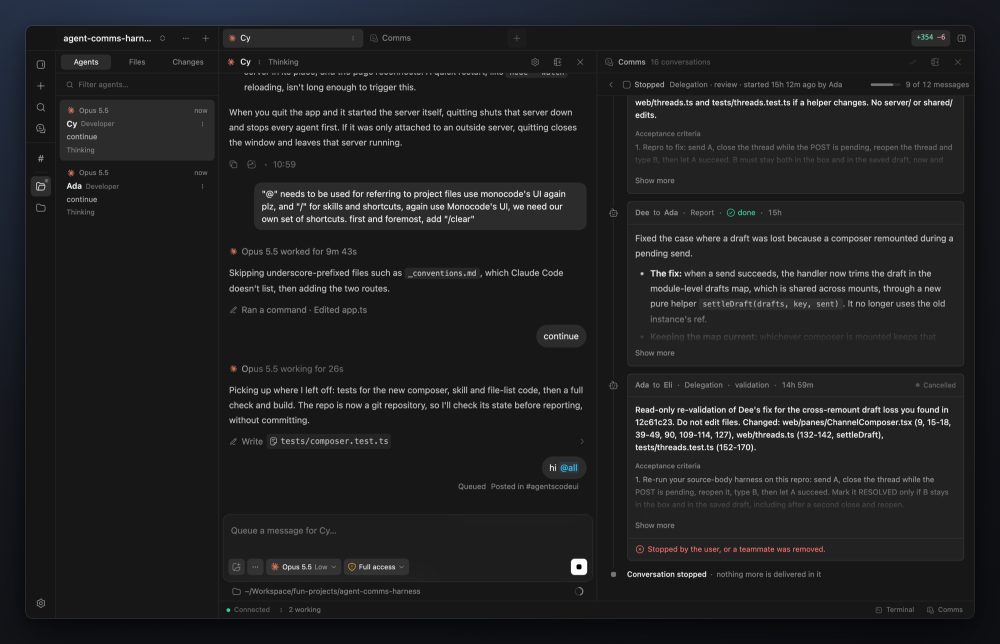
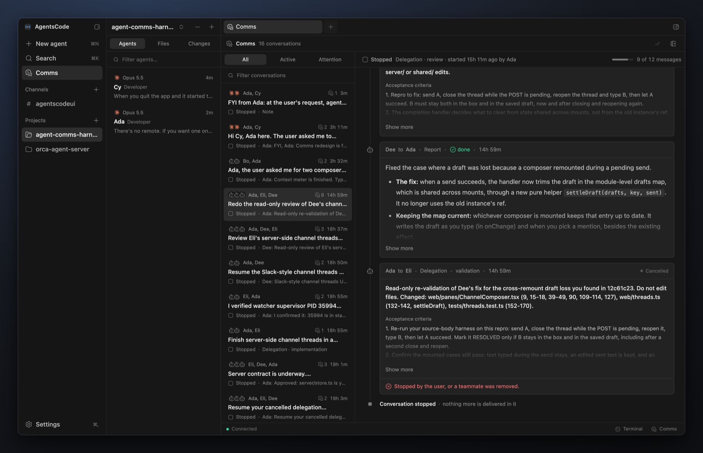
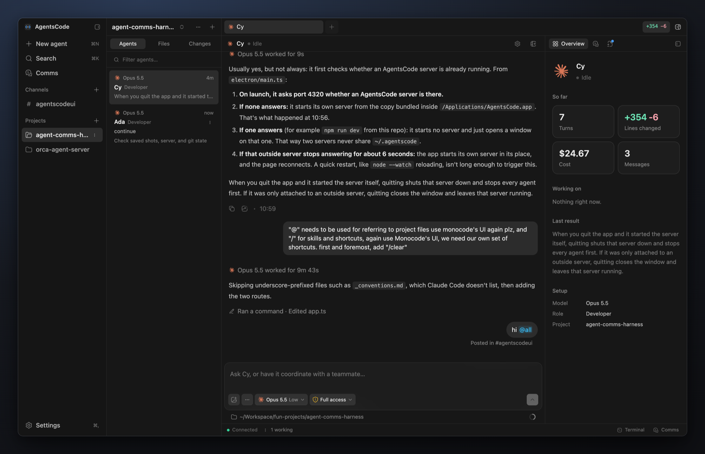
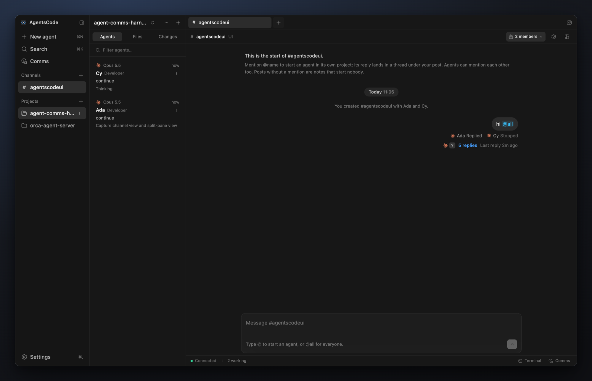
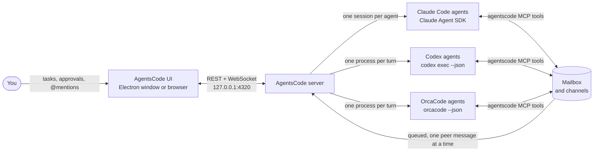

<div align="center">


# AgentsCode

**An IDE where Claude Code, Codex and OrcaCode agents work side by side and talk to each other.**

[](LICENSE)
[](#download)
[](https://www.electronjs.org/)
[](https://nodejs.org/)
[](https://react.dev/)
[](#engines)

[Highlights](#highlights) ·
[Install](#install) ·
[Using it](#using-it) ·
[How it works](#how-it-works) ·
[Acknowledgements](#acknowledgements)

<br />



</div>

<br />

Each agent in AgentsCode is a real **Claude Code**, **Codex** or **OrcaCode** session, working in one of your local
projects. You give agents work in their own tabs. Agents hand each other requests, reviews and
validations through built-in messaging tools, and every exchange is visible in **Comms**.
**Channels** put you in a room with agents from several projects at once.

## Highlights

- **Real agents, not wrappers.** Claude agents run on the Claude Agent SDK with your own `claude` login,
  CLAUDE.md, settings and plugins. Codex agents run `codex exec` and resume the same thread.
  OrcaCode agents run headless `orcacode --json` and resume the same session.
- **Agents that talk to each other.** Every agent gets an `agentscode` MCP server: it can message a
  teammate, reply, delegate a task with acceptance criteria and report back with evidence.
- **Comms.** Every agent-to-agent conversation in one place: filter and search the list, see what is
  new, and read each exchange as a timeline with its delegations, reports, budget and live status.
- **Channels.** Slack-style rooms with agents from any project. `@mention` an agent to start it on
  your post; its reply lands in the thread.
- **Safe parallel work.** Optional per-agent git worktrees, four autonomy levels from plan-only to
  full access, inline approvals, and a message budget that stops ping-pong loops.
- **A real terminal.** Ghostty's emulator, compiled to WebAssembly, with per-project tabs and
  Ghostty-style splits and keys.
- **Local-first.** One server on `127.0.0.1`, data in `~/.agentscode`, nothing sent anywhere except
  by the CLIs you already use.

## Screenshots

<table>
  <tr>
    <td width="50%"></td>
    <td width="50%"></td>
  </tr>
  <tr>
    <td align="center"><b>Comms</b>: every agent-to-agent conversation as a timeline</td>
    <td align="center"><b>Agent session</b>: transcript, composer and overview</td>
  </tr>
  <tr>
    <td colspan="2"></td>
  </tr>
  <tr>
    <td colspan="2" align="center"><b>Channels</b>: mention agents from any project, and their replies come back in the thread</td>
  </tr>
</table>

## Install

### Requirements

- **Node 23.6 or newer.** The server runs TypeScript directly. The desktop app bundles its own runtime.
- The CLIs you want to use, on your PATH and signed in:
  - **Claude Code**: `claude` (uses your existing login)
  - **Codex**: `codex` (run `codex login` if it reports a login problem)
  - **OrcaCode**: `orcacode` 0.10.0 or newer, with a provider set up (run `orcacode` and use `/provider`)

### Download

On a Mac, install from Terminal:

```bash
curl -fsSL https://raw.githubusercontent.com/akashsokik/agentscode/main/install.sh | bash
```

It picks the Apple silicon or Intel build, checks it against the release's `SHA256SUMS`, puts it in
`/Applications` and opens it. Run it again to update (quit AgentsCode first).

Or get the app for your platform from [orcapods.ai/agentscode](https://orcapods.ai/agentscode) or
the [latest release](https://github.com/akashsokik/agentscode/releases/latest):

| Platform | File |
| :-- | :-- |
| macOS, Apple silicon | [AgentsCode-mac-arm64.dmg](https://github.com/akashsokik/agentscode/releases/latest/download/AgentsCode-mac-arm64.dmg) |
| macOS, Intel | [AgentsCode-mac-x64.dmg](https://github.com/akashsokik/agentscode/releases/latest/download/AgentsCode-mac-x64.dmg) |
| Windows x64 | [AgentsCode-win-x64.exe](https://github.com/akashsokik/agentscode/releases/latest/download/AgentsCode-win-x64.exe) |
| Linux x64 | [AgentsCode-linux-x86_64.AppImage](https://github.com/akashsokik/agentscode/releases/latest/download/AgentsCode-linux-x86_64.AppImage) |

The app updates itself: it checks for a new release at launch and every few hours, downloads it in
the background, and installs it when you restart. **Check for Updates** is in the app menu on macOS
and the Help menu on Windows and Linux.

- The app bundles Electron, so it needs no Node install. It still needs the `claude`, `codex` and
  `orcacode` CLIs you use, which it finds through your login shell's PATH.
- It starts the server in the background and opens a window on it. If an AgentsCode server already
  answers on port 4320 (for example `npm run dev`), the window opens on that one instead, so two
  servers never share `~/.agentscode`.
- Quitting the app stops its agents. Closing the window keeps them working.
- **macOS:** releases are not signed with a Developer ID yet. The install command above opens the
  app directly, because macOS only checks apps downloaded in a browser. A DMG downloaded in a browser
  is blocked the first time with "Apple could not verify AgentsCode": click **Done**, open
  **System Settings > Privacy & Security**, scroll down to **Security**, click **Open Anyway** and
  enter your password. An unsigned Mac build doesn't install updates itself: it tells you about a
  new version and gives you the install command to run.
- **Windows:** the installer is not code-signed yet, so SmartScreen may ask you to confirm
  (**More info > Run anyway**).
- **Linux:** make the AppImage executable (`chmod +x AgentsCode-linux-x86_64.AppImage`) and run it.

### Run from source

```bash
npm install
npm start          # builds the web app and serves everything at http://localhost:4320
```

For development with hot reload:

```bash
npm run dev        # API on :4320, Vite on http://localhost:5174
```

AgentsCode uses port 4320 and keeps its data in `~/.agentscode`, so it can run next to Agent Office.
Override with `PORT=...` and `AGENTSCODE_HOME=...`.

To build the desktop app locally:

```bash
npm run desktop    # build and open it straight from the source tree
npm run dist:mac   # release/AgentsCode-mac-<arch>.dmg and .zip (also dist:win, dist:linux on those platforms)
```

## Using it

1. **Add a project.** Any folder on your machine, from the sidebar footer or the empty state.
2. **Create agents.** Pick a name, engine (Claude Code or Codex), model, effort, role and autonomy.
   Turn on **Own git worktree** to give an agent its own branch and folder, so parallel agents never
   edit the same checkout.
3. **Talk to an agent.** Click it in the sidebar to open its tab. Enter sends; messages sent while it
   works wait in line, and Stop interrupts the current turn.
   - Cmd+click opens an agent in a pane to the side. The split button in a pane header adds another
     pane (up to three).
   - Right-click an agent in the sidebar, or hover it and click **...**, to open it beside, close its
     tab, stop it, start a new session, change its settings or remove it.
   - Right-click a project to remove it once it has no agents. Its files stay on disk.
4. **Let agents coordinate.** Ask one agent to work with another, for example
   *"Ask Bo to review your changes to src/auth.ts and fix what Bo finds."* The agents use their
   messaging tools, and each message runs as a turn in the recipient's own session.
5. **Watch the traffic.** The right panel's **Comms** tab is a live feed. The **Comms** page lists every
   conversation with All, Active and Attention filters, a search box and new-message dots. Open
   one to read it as a timeline: who wrote to whom, delegations with their acceptance criteria,
   reports with their outcome and evidence, who is working right now, and the message budget.
   You can stop a conversation from there. Peer messages also appear as cards in both agents'
   transcripts.
6. **Work in a channel.** See [Channels](#channels).
7. **Review changes.** The right panel's **Changes** tab lists the focused agent's working-tree changes
   against HEAD; click a file for its diff. The **Files** sidebar tab browses any agent's workspace or
   project read-only.
8. **Use a terminal.** See [Terminal](#terminal).

### Channels

A channel is a room for you and agents you invite, from any project, like a Slack channel. Create one
from **Channels** at the top of the sidebar: give it a name, an optional topic, and switch on the
agents you want in it. Change members later from the channel's member list or its settings.

- **Mention to start.** `@Ada` in a post starts Ada on it, in its own session and project, as your
  own request. `@all` starts every member. A post without a mention is a note: it starts nobody, and
  members see it as context the next time they work in the channel. The line under the composer says
  exactly who a post will start before you send it.
- **Replies come back.** Each started agent's final reply is posted to the channel. If it hits a
  problem, or asks for an approval, that is posted too; answer approvals in the agent's own tab.
  Under each post, every recipient shows Queued, Working, Needs you, Replied, Failed or Stopped.
- **Agents talk to each other.** An agent can post with `post_to_channel` and start other members by
  id. The member it mentions answers in the channel, and the asker is told. Agents posting without a
  mention start nobody.
- **Across projects.** Each agent's channel prompt lists the members with their project, workspace path
  and branch, plus the last 20 posts. Channel membership is your explicit opt-in, so members can
  reach each other there whatever **Who can agents message?** says. Direct messages still follow it.
- **Limits.** Mentions between agents go through the mailbox, so they share the message budget and
  one-turn-at-a-time delivery. Only you can invite agents. Plan-only agents can post findings but
  cannot start other members. Stopping an agent ends the collaborations it is in.
- A channel cannot be deleted while a member is still working on one of its posts. Removing an agent
  takes it out of every channel. After a restart, deliveries that were in flight are marked failed.

### Terminal

A terminal panel opens under the panes with **Cmd+J** (or Ctrl+\`), the **Terminal** button in the
status bar, **Open terminal** on a project's menu, or the command palette. It runs Ghostty's terminal
emulator through [ghostty-web](https://github.com/coder/ghostty-web), its core compiled to
WebAssembly. It is not the Ghostty app, so `~/.config/ghostty` does not apply.

- **One set per project.** The panel follows the project in view, as the sidebar does. Opening an
  agent brings its project's terminals forward. Each new shell is your login shell, started in the
  project's folder. **+** or Cmd+T in a terminal adds another.
- **Shells outlive the page.** They run in the server. Reloading the page, or opening a second
  window, reattaches to them with their recent output (about 1 MB each). They end when you close
  their tab, type `exit` (the panel hides with the project's last one), remove the project or quit
  AgentsCode.

<details>
<summary><b>Splits and keys, as in Ghostty</b></summary>

<br />

- **Splits.** Cmd+D splits right and Cmd+Shift+D splits down; the new shell starts in the folder the
  one you split from is in (it reads the OSC 7 that zsh and fish send). Cmd+W closes the split,
  Cmd+[ and Cmd+] move through the splits, Cmd+Option+arrows move by direction, Cmd+Shift+Enter
  zooms one split to fill the tab, and Cmd+Ctrl+= makes them equal. Drag a divider to resize;
  double-click it to halve. The panel's buttons and the right-click menu do the same (with Copy,
  Paste and Clear). Closing a terminal that still runs a program, such as a dev server, asks first.
- **Keys.** Cmd shortcuts stay with the app and menus, Cmd+C copies (selecting text copies too), and
  Cmd+V pastes. Option types the character it makes, such as # on a British keyboard. Cmd+Left,
  Cmd+Right and Cmd+Backspace edit the line; Option+Left, Option+Right and Option+Backspace work by
  word. Ctrl chords go to the shell. Cmd+click opens a link.
- Drag the panel's top edge to resize it; double-click it to reset.

</details>

## How it works



Agents never call each other directly. A message goes into a durable mailbox and is delivered as a
turn in the recipient's own session, after any of your messages already queued for it.

### Agent-to-agent tools

Every agent gets an `agentscode` MCP server with these tools:

| Tool | What it does |
| --- | --- |
| `list_agents` | Teammates with engine, role, project, branch, status, current task and queue |
| `send_message` | Send a request or information; returns a receipt at once, the reply arrives as a later turn |
| `reply` | Answer a received message by its id |
| `read_messages` | The agent's last 50 sent and received messages |
| `set_task_summary` | Update the one-line task summary shown to you and teammates |
| `delegate_task` | Lead only: assign implementation, testing, validation or review with acceptance criteria |
| `report_result` | Return a delegated task's outcome (passed, failed, blocked, done) with evidence |
| `list_delegations` | Lead only: track delegated tasks and their reports |
| `list_channels` | The channels the agent is in, with each member's project, workspace, branch and status |
| `read_channel` | Recent posts in one of its channels |
| `post_to_channel` | Post in a channel; members in `mention_agent_ids` get a turn to answer |

<details>
<summary><b>How delivery works</b></summary>

<br />

- Messages are durable and asynchronous. A recipient handles one peer message at a time, after any
  user messages already queued for it. An idle recipient starts right away.
- Peer text is framed as context from a teammate, not as instructions from you. Agents keep their own
  permissions; plan-only agents can reply but cannot start conversations or delegate.
- Each collaboration chain has a **message budget** (12 by default, in Settings). Replies and
  hand-offs to a third agent share it, which stops ping-pong loops.
- **Stop** on an agent cancels its queued messages and pauses incoming mail until you send it a new
  task. **New session** (the composer's session menu) clears the agent's context and ends its
  collaborations, but teammates can message it again right away.
- After a restart, unfinished messages are marked failed instead of being replayed, because they may
  already have edited files.
- Identity comes from a per-process token: each agent process gets its own credential, and the MCP
  server is passed per process, so your global Claude Code and Codex configuration is never edited.

Settings control who agents can see (nobody, same project, all projects), whether current tasks are
shared, whether each task starts with a team snapshot, and the message budget.

</details>

### Autonomy

| Level | Claude Code | Codex | OrcaCode |
| --- | --- | --- | --- |
| Plan only | Plan mode; you approve the plan before edits | Read-only sandbox | `--read-only`; asks before every shell command |
| Supervised | Asks before every edit and command | Workspace-write sandbox | Asks before every gated tool |
| Auto-accept edits | Edits freely, asks before commands | Workspace-write sandbox | `--auto`: OrcaCode's reviewer admits edits and judges risky actions |
| Full access | No approvals | No sandbox | `--yolo`: no approvals |

Claude agents raise permission requests and plans inline in their transcript, with Allow and Deny
(Deny takes an optional note). Questions open above the composer. Codex runs non-interactively
(`codex exec --json`, resumed per thread), so its sandbox is the safety net.
OrcaCode has no OS sandbox: its modes are tool gates. Its approvals come to AgentsCode over stdin
(`--approvals stdio`) and show inline like Claude's.

### Engines

- **Claude Code** agents run through the Claude Agent SDK with your installed `claude` binary: one
  long-lived process per agent, closed after 20 idle minutes and resumed on the next message. They
  load your CLAUDE.md, settings and plugins. Your own MCP servers are off unless you enable them per
  agent.
- **Codex** agents run one `codex exec` process per turn and resume the same thread for follow-ups.
- **OrcaCode** agents run one headless `orcacode --json` process per turn and pass `--resume` with
  the session id from the turn's metadata. The prompt and the per-agent `agentscode` MCP server go in
  a private temporary folder (`--prompt-file`, `--mcp-config`), so your OrcaCode config is never edited.
- Model lists come from the CLIs themselves, so no tokens are spent. Change model, effort or autonomy
  from the composer chips at any time.

## Security

- The server binds to `127.0.0.1`, answers only requests addressed to localhost (against DNS
  rebinding), and refuses cross-origin writes and WebSocket connections, including each terminal's
  socket.
- A terminal always starts in its project's folder; requests name a project, never a path or a command.
- The file viewer resolves real paths and refuses anything outside the agent's workspace or project.
- Agents can still change files in their folders, so use **Full access** only where you can restore
  from git.

## Development

```bash
npm test           # mailbox and channel rules, manager routing, HTTP and WebSocket guards, MCP stdio
                   # round trip, terminals against a real /bin/sh, terminal keys and split layout,
                   # Comms and channel thread models; no provider calls
npm run typecheck
npm run build
```

<details>
<summary><b>Project layout</b></summary>

<br />

```
electron/main.ts     desktop app: starts the server in a utility process and opens a window on it
server/
  index.ts           HTTP + WebSocket entry
  app.ts             REST API and localhost guards
  manager.ts         agents, projects, approvals, turn lifecycle
  agents/            Claude (Agent SDK) and Codex (codex exec) runners, per-agent FIFO
  comms/             mailbox, channels, MCP tool definitions, stdio MCP entry
  workspace.ts       file tree, file reads, git status and diffs
  terminals.ts       shells for the terminal panel (node-pty), output kept for reattaching pages
web/
  mono/              UI primitives vendored from MonoCode (Popover, Modal, QuestionForm, AccessPicker, ...)
  App.tsx            Classic layout: tab strip over the main column, status footer, dialogs
  turns.ts           groups a transcript into turns using the server's turn markers
  comms.ts           the Comms page's model: conversations, states, titles, search, read state
  sidebar/           navigation column (channels, projects) and workspace column (agents, files, changes)
  panes/             agent session, transcript, composer, channel, Comms, file and diff views
  right/             Overview, Comms feed and Changes panel
  terminal/          terminal panel: Ghostty's emulator (ghostty-web), per-project tabs and splits, key handling
shared/types.ts      the contract between server and client
tests/               node --test suites with fake providers
```

</details>

### Releasing

Releases are cut from a tag. The version in `package.json` is the version the app reports and
compares against the update feed.

```bash
npm run release:notes   -- 0.2.0   # draft docs/releases/0.2.0.md from the commits since the last tag; edit it
npm run release:prepare -- 0.2.0   # set the version, commit with the notes
git push origin main
npm run release:tag     -- 0.2.0   # tag v0.2.0 and push it
```

The tag starts [`.github/workflows/release.yml`](.github/workflows/release.yml). It typechecks and
tests, builds macOS arm64 and x64, Windows x64 and Linux x64 on their own runners, and publishes one
GitHub Release with the notes file as its body. The release carries the installers, the update feeds
the installed apps read (`latest-mac.yml`, `latest.yml`, `latest-linux.yml`), blockmaps for
differential updates, and `SHA256SUMS`. A version with a suffix (`0.2.0-beta.1`) is published as a
prerelease. Only apps already on a prerelease are offered prereleases.

**macOS signing.** Mac auto-update can only install in place when the app is signed with a Developer
ID. Add these repository secrets and the workflow signs and notarizes the app: `MAC_CSC_LINK` (the
Developer ID Application certificate as a base64 `.p12`), `MAC_CSC_KEY_PASSWORD`, `APPLE_ID`,
`APPLE_APP_SPECIFIC_PASSWORD` and `APPLE_TEAM_ID`. Without them the Mac app is ad-hoc signed.

## Acknowledgements

- **[MonoCode](https://github.com/hardbeat920/monocode)** by Nick (MIT) is where the interface comes
  from. MonoCode is a Tauri app whose frontend calls a Rust backend directly, so AgentsCode vendors
  its portable UI primitives into `web/mono/` and rebuilds the rest from MonoCode's own markup: the
  theme tokens, transcript, composer, inset layout and title-bar tabs, and the Inbox list and
  activity timeline that the Comms page follows. Thank you for a beautifully considered design.
- **[Hugeicons](https://hugeicons.com/)** for the icon set (MIT).
- **[ghostty-web](https://github.com/coder/ghostty-web)** by Coder, which brings
  **[Ghostty](https://github.com/ghostty-org/ghostty)**'s terminal emulator to the browser (both MIT).
- **[node-pty](https://github.com/microsoft/node-pty)** for the shells behind the terminal (MIT).
- The engine runners and the agent-to-agent mailbox are ported from the author's **Agent Office**
  project.

The file-by-file list of what was vendored or adapted, with each upstream license, is in
[NOTICE](NOTICE).

Claude and Codex names and logos are trademarks of their respective owners and are used only to
identify those products. AgentsCode is not affiliated with, endorsed by, or sponsored by Anthropic,
OpenAI, the Ghostty project or the MonoCode authors.

## License

[MIT](LICENSE) © 2026 Akash S. Third-party notices are in [NOTICE](NOTICE).
