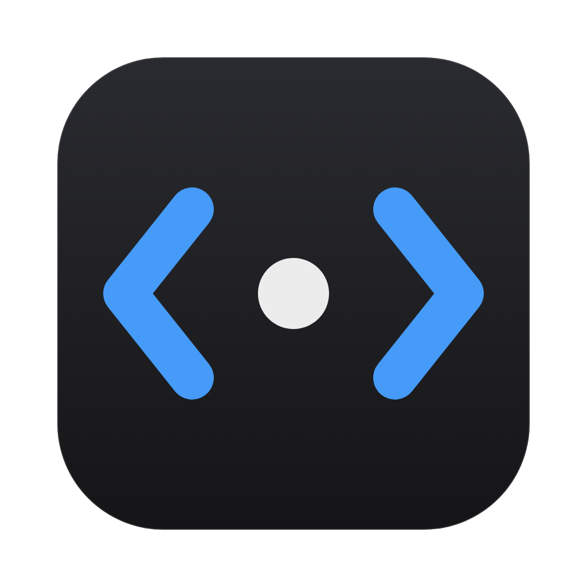
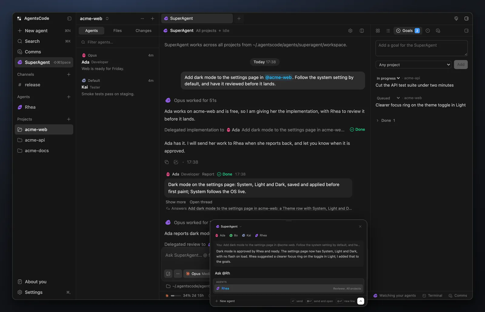
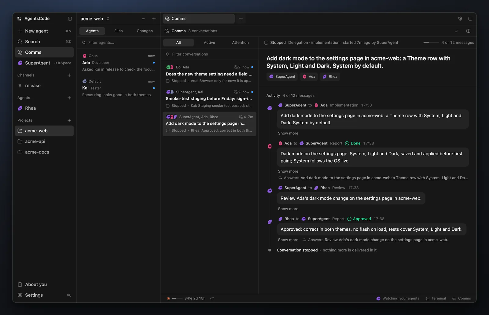
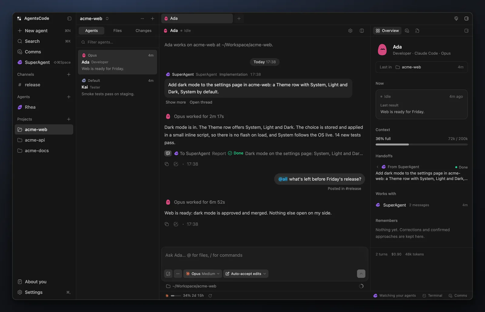
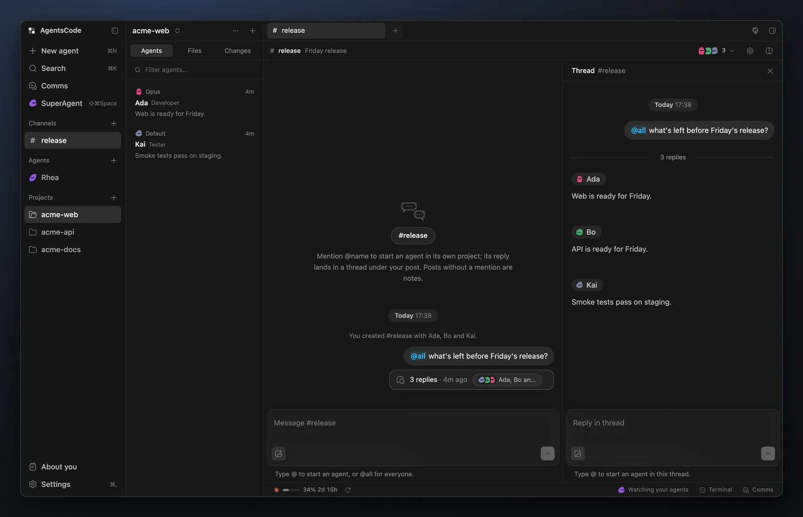
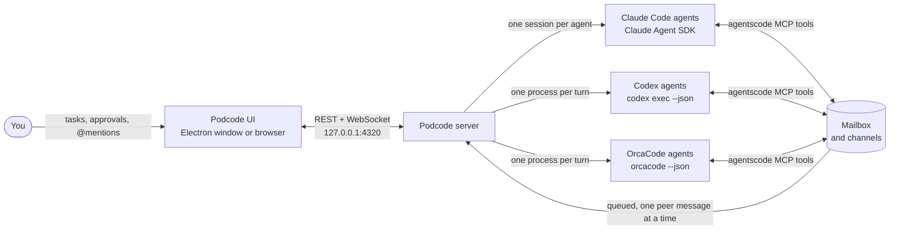

<div align="center">



# Podcode

**The desktop app where your coding agents message each other.**<br />
Claude Code, Codex and OrcaCode agents side by side, asking each other for reviews, delegating and reporting back.

By [Orca](https://orcapods.ai) · [podcode.orcapods.ai](https://podcode.orcapods.ai)

[](LICENSE)
[](#download)
[](https://www.electronjs.org/)
[](https://nodejs.org/)
[](https://react.dev/)
[](#engines)

[Highlights](#highlights) ·
[Install](#install) ·
[Using it](#using-it) ·
[SuperAgent](#superagent) ·
[Shortcuts](#keyboard-shortcuts) ·
[How it works](#how-it-works) ·
[Development](#development)

<br />



</div>

<br />

A pod is a group of orcas that hunt together and talk the whole time. Podcode does that for coding
agents. Each agent is a real **Claude Code**, **Codex** or **OrcaCode** session, working in one of
your local projects. Agents hand each other requests, reviews and validations through built-in
messaging tools: one asks another to review its change, delegates a task with acceptance criteria,
and gets a report back with evidence. Every exchange is visible in **Comms**. **Channels** put you
in a room with agents from several projects at once, and the **SuperAgent** runs the team across
every project for you.

Podcode was called AgentsCode until 0.3.0. Your agents, projects and settings carry over.

## Highlights

- **Real agents, not wrappers.** Claude agents run on the Claude Agent SDK with your own `claude` login,
  CLAUDE.md, settings and plugins. Codex agents run `codex exec` and resume the same thread.
  OrcaCode agents run headless `orcacode --json` and resume the same session.
- **Agents that talk to each other.** Every agent gets an `agentscode` MCP server: it can message a
  teammate, reply, delegate a task with acceptance criteria and report back with evidence.
- **Comms.** Every agent-to-agent conversation in one place: filter and search the list, see what is
  new, and read each exchange as a timeline with its delegations, reports, budget and live status.
- **Channels.** Slack-style rooms with agents from any project. `@mention` an agent to start it on
  your post; its reply lands in the thread.
- **SuperAgent.** One read-only agent that runs the team across every project: it watches your
  agents, works a goals backlog, messages and delegates, and asks you about the rest. Talk to it from
  anywhere with the quick window (Shift+Cmd+Space). See [SuperAgent](#superagent).
- **Memory, soul and dreams.** Each agent keeps standing instructions (its soul) and what it learned
  (its memory), and reviews its own sessions to propose small updates. A shared user profile tells
  every agent how you like to work.
- **@-mentions.** One picker in every composer for agents, projects and files.
- **Safe parallel work.** Optional per-agent git worktrees, four autonomy levels from plan-only to
  full access, inline approvals, and a message budget that stops ping-pong loops.
- **A real terminal and a browser.** Ghostty's emulator, compiled to WebAssembly, with per-project
  tabs and Ghostty-style splits and keys; and, in the desktop app, browser tabs for localhost previews
  that agents can drive too.
- **Local-first.** One server on `127.0.0.1`, data in `~/.agentscode`, nothing sent anywhere except
  by the CLIs you already use.

## Screenshots

<table>
  <tr>
    <td width="50%"></td>
    <td width="50%"></td>
  </tr>
  <tr>
    <td align="center"><b>Comms</b>: every agent-to-agent conversation as a timeline</td>
    <td align="center"><b>Agent session</b>: transcript, composer and Overview</td>
  </tr>
  <tr>
    <td colspan="2"></td>
  </tr>
  <tr>
    <td colspan="2" align="center"><b>Channels</b>: mention agents from any project, and their replies come back in the thread</td>
  </tr>
</table>

The screenshots show demo data.

## Install

### Requirements

- **Node 23.6 or newer.** The server runs TypeScript directly. The desktop app bundles its own runtime.
- The CLIs you want to use, on your PATH and signed in:
  - **Claude Code**: `claude` (uses your existing login)
  - **Codex**: `codex` (run `codex login` if it reports a login problem)
  - **OrcaCode**: `orcacode` 0.10.0 or newer, with a provider set up (run `orcacode` and use `/provider`).
    An OrcaCode agent that works across all projects needs 0.12.0 or newer.

### Download

On a Mac, you can install from Terminal:

```bash
curl -fsSL https://raw.githubusercontent.com/akashsokik/agentscode/main/install.sh | bash
```

It picks the Apple silicon or Intel build, checks it against the release's `SHA256SUMS`, puts it in
`/Applications` and opens it. Run it again to update (quit Podcode first).

Or get the app for your platform from [podcode.orcapods.ai](https://podcode.orcapods.ai) or
the [latest release](https://github.com/akashsokik/agentscode/releases/latest):

| Platform | File |
| :-- | :-- |
| macOS, Apple silicon | [Podcode-mac-arm64.dmg](https://github.com/akashsokik/agentscode/releases/latest/download/Podcode-mac-arm64.dmg) |
| macOS, Intel | [Podcode-mac-x64.dmg](https://github.com/akashsokik/agentscode/releases/latest/download/Podcode-mac-x64.dmg) |
| Windows x64 | [Podcode-win-x64.exe](https://github.com/akashsokik/agentscode/releases/latest/download/Podcode-win-x64.exe) |
| Linux x64 | [Podcode-linux-x86_64.AppImage](https://github.com/akashsokik/agentscode/releases/latest/download/Podcode-linux-x86_64.AppImage) |

#### Updating

The app updates itself: it checks for a new release at launch and every few hours, and **Update to**
the new version in the sidebar (or **Check for Updates** in the app menu on macOS and the Help menu
on Windows and Linux) downloads it, stops the agents and restarts into the new version. A Mac build
that is not signed with a Developer ID (versions up to 0.2.2, or a build from a fork) cannot replace
itself: it tells you about the new version and gives you the install command to run in Terminal
(quit Podcode first). **Settings > About** (or **About Podcode**, in the app menu on macOS and
the Help menu on Windows and Linux) shows the version, its build, the update status with
**Check for updates**, the install command on an unsigned Mac build, and a link to the release
notes.

- The app bundles Electron, so it needs no Node install. It still needs the `claude`, `codex` and
  `orcacode` CLIs you use, which it finds through your login shell's PATH.
- It starts the server in the background and opens a window on it. If a Podcode server already
  answers on port 4320 (for example `npm run dev`), the window opens on that one instead, so two
  servers never share `~/.agentscode`.
- Quitting the app stops its agents. Closing the window keeps them working.
- **macOS:** from 0.2.3, releases are signed with a Developer ID and notarized by Apple, so the DMG
  opens like any other downloaded app and installs its own updates. Versions up to 0.2.2 were not
  signed: a DMG of one of those downloaded in a browser is blocked the first time ("Apple could not
  verify AgentsCode"; System Settings > Privacy & Security > Open Anyway), and they can't install a
  signed update themselves, so update one of those once by downloading the DMG again or running the
  install command above.
  When an AgentsCode install updates itself to Podcode, the app in Applications is renamed to
  `Podcode.app`, but it doesn't reopen on its own that one time: open Podcode from Applications.
- **Windows:** the installer is not code-signed yet, so SmartScreen may ask you to confirm
  (**More info > Run anyway**).
- **Linux:** make the AppImage executable (`chmod +x Podcode-linux-x86_64.AppImage`) and run it.

### Run from source

```bash
npm install
npm start          # builds the web app and serves everything at http://localhost:4320
```

For development with hot reload:

```bash
npm run dev        # API on :4320, Vite on http://localhost:5174
```

Podcode uses port 4320 and keeps its data in `~/.agentscode`, so it can run next to Agent Office.
Override with `PORT=...` and `AGENTSCODE_HOME=...`.

To build the desktop app locally:

```bash
npm run desktop    # build and open it straight from the source tree
npm run dist:mac   # release/Podcode-mac-<arch>.dmg and .zip (also dist:win, dist:linux on those platforms)
```

## Using it

1. **Add a project.** Any folder on your machine, from the sidebar footer or the empty state.
2. **Create agents.** Pick a name, engine (Claude Code, Codex or OrcaCode), project (or All
   projects), model, effort, role and autonomy. The roles are Developer, Lead, Reviewer, Tester,
   Planner, Scout and Custom; each sets the agent's starting instructions and autonomy. Turn on
   **Own git worktree** to give an agent its own branch and folder, so parallel agents never edit the
   same checkout. Each agent gets its own avatar, whose eyes show its state (working, waiting on you,
   done, failed); pick another shape and colour in its settings.
3. **Talk to an agent.** Click it in the sidebar to open its tab. Enter sends; messages sent while it
   works wait in line, and Stop interrupts the current turn.
   - Cmd+click opens an agent in a pane to the side. The split button in a pane header adds another
     pane (up to three).
   - Right-click an agent in the sidebar, or hover it and click **...**, to open it beside, close its
     tab, stop it, start a new session, change its settings or remove it.
   - Right-click a project to remove it once it has no agents. Its files stay on disk.
4. **Let agents coordinate.** Ask one agent to work with another, for example
   *"Ask Bo to review your changes to src/auth.ts and fix what Bo finds."* The agents use their
   messaging tools, and each message runs as a turn in the recipient's own session.
5. **Watch the traffic.** The right panel's **Comms** tab is a live feed. The **Comms** page lists every
   conversation with All, Active and Attention filters, a search box and new-message dots. Open
   one to read it as a timeline: who wrote to whom, delegations with their acceptance criteria,
   reports with their outcome and evidence, who is working right now, and the message budget.
   You can stop a conversation from there. Peer messages also show in both agents' transcripts: a
   teammate's message opens its turn like yours does, and handoffs are quiet rows that follow the work
   to its report.
6. **Work in a channel.** See [Channels](#channels).
7. **Review changes.** The right panel's **Changes** tab lists the focused agent's working-tree changes
   against HEAD; click a file for its diff. The **Files** sidebar tab browses any agent's workspace or
   project read-only.
8. **Use a terminal.** See [Terminal](#terminal).
9. **Preview in the browser.** In the desktop app, **Shift+Cmd+B** opens a browser tab. A localhost
   link in a reply opens in a browser tab beside you when you click it, and agents have browser tools
   (open, snapshot, screenshot, console, click, type) to check web work in their own tabs.

### @-mentions

Type `@` in any composer (an agent's, a channel's, the quick window's) for one picker with
**Agents**, **Projects** and **Files**.

- In an agent's composer, `@Agent` and `@project` are references: the agent is told exactly who or
  what you mean (an agent's id, role and project; a project's path). Mentioning an agent there does
  not message it. `@path` is a file or folder in the agent's workspace.
- In a channel, `@Agent` also starts that member on your post, and `@all`, `@channel` or `@here`
  start every member. Files there are written `project/path`.
- A name inside backticks or a code block is not a mention. Names with spaces work, and when an agent
  and a project share a name, the one you picked from the picker is the one you get.

### Memory, soul and dreams

Each agent has a private home in `~/.agentscode/agents/<id>/`, outside its working folder:

- **Soul** (`soul.md`): its standing instructions. You write it, in **Agent Settings > Soul** or by
  hand.
- **Memory** (`memory.md`): what it learned. Agents save entries with their `remember` tool when you
  correct them or confirm an approach, and you can edit them in **Agent Settings > Memory**.
- **Dreams**: after a session (at least three turns, and an hour since the last dream), an agent
  reviews a digest of what happened and proposes small memory changes and, now and then, a soul
  change, which waits for you. Every dream is recorded in **Agent Settings > Dreaming**, and its
  changes can be undone; **Dream now** there runs one at once.
- **About you** (`~/.agentscode/user.md`): a profile of you shared by every agent: your style, taste
  and how you like to work. What you say outright is saved directly; what a dream infers waits for
  your approval. See and edit it under **About you** in the sidebar.

### Channels

A channel is a room for you and agents you invite, from any project, like a Slack channel. Create one
from **Channels** at the top of the sidebar: give it a name, an optional topic, and switch on the
agents you want in it. Change members later from the channel's member list or its settings.

- **Mention to start.** `@Ada` in a post starts Ada on it, in its own session and project, as your
  own request. `@all` starts every member. A post without a mention is a note: it starts nobody, and
  members see it as context the next time they work in the channel. The line under the composer says
  exactly who a post will start before you send it.
- **Replies come back.** Each started agent's final reply is posted to the channel. If it hits a
  problem, or asks for an approval, that is posted too; answer approvals in the agent's own tab.
  Under each post, every recipient shows Queued, Working, Needs you, Replied, Failed or Stopped.
- **Agents talk to each other.** An agent can post with `post_to_channel` and start other members by
  id. The member it mentions answers in the channel, and the asker is told. Agents posting without a
  mention start nobody.
- **Across projects.** Each agent's channel prompt lists the members with their project, workspace path
  and branch, plus the last 20 posts. Channel membership is your explicit opt-in, so members can
  reach each other there whatever **Who can agents message?** says. Direct messages still follow it.
- **Limits.** Mentions between agents go through the mailbox, so they share the message budget and
  one-turn-at-a-time delivery. Only you can invite agents. Plan-only agents can post findings but
  cannot start other members. Stopping an agent ends the collaborations it is in.
- A channel cannot be deleted while a member is still working on one of its posts. Removing an agent
  takes it out of every channel.

### Terminal

A terminal panel opens under the panes with **Cmd+J** (or Ctrl+\`), the **Terminal** button in the
status bar, **Open terminal** on a project's menu, or the command palette. It runs Ghostty's terminal
emulator through [ghostty-web](https://github.com/coder/ghostty-web), its core compiled to
WebAssembly. It is not the Ghostty app, so `~/.config/ghostty` does not apply.

- **One set per project.** The panel follows the project in view, as the sidebar does. Opening an
  agent brings its project's terminals forward. Each new shell is your login shell, started in the
  project's folder. **+** or Cmd+T in a terminal adds another.
- **Shells outlive the page.** They run in the server. Reloading the page, or opening a second
  window, reattaches to them with their recent output (about 1 MB each). They end when you close
  their tab, type `exit` (the panel hides with the project's last one), remove the project or quit
  Podcode.

<details>
<summary><b>Splits and keys, as in Ghostty</b></summary>

<br />

- **Splits.** Cmd+D splits right and Cmd+Shift+D splits down; the new shell starts in the folder the
  one you split from is in (it reads the OSC 7 that zsh and fish send). Cmd+W closes the split,
  Cmd+[ and Cmd+] move through the splits, Cmd+Option+arrows move by direction, Cmd+Shift+Enter
  zooms one split to fill the tab, and Cmd+Ctrl+= makes them equal. Drag a divider to resize;
  double-click it to halve. The panel's buttons and the right-click menu do the same (with Copy,
  Paste and Clear). Closing a terminal that still runs a program, such as a dev server, asks first.
- **Keys.** Cmd shortcuts stay with the app and menus, Cmd+C copies (selecting text copies too), and
  Cmd+V pastes. Option types the character it makes, such as # on a British keyboard. Cmd+Left,
  Cmd+Right and Cmd+Backspace edit the line; Option+Left, Option+Right and Option+Backspace work by
  word. Ctrl chords go to the shell. Cmd+click opens a link.
- Drag the panel's top edge to resize it; double-click it to reset.

</details>

## SuperAgent

The SuperAgent is one agent that runs the team for you across every project. It never edits: its
autonomy is read-only on every engine, it has no edit tools, and no shell on Claude Code or
OrcaCode (on Codex its commands run in the read-only sandbox), and every change goes through an
agent it delegates to. Open it from **SuperAgent** in the sidebar.

- **What it does on its own.** It watches your agents (it wakes when one finishes, fails, gets
  stuck or waits for you), works a goals backlog top down, creates agents and channels, adds or
  removes channel members, delegates, nudges a stuck agent, starts a new session and stops a runaway
  turn. Each command carries a short reason.
- **What it asks you first.** Merging, pushing or deploying, deleting anything, removing an agent,
  adding a project, and large or costly work. Its questions appear above its composer, as desktop
  notifications, and in the quick window, with the choices to click. It bases its decisions on About
  you, so what you tell it there (for example, which of these it may do without asking) is what it
  goes by.
- **Morning brief.** Once a day, the first time it may wake after quiet hours, it tells you what
  happened since yesterday, what is stuck, and what it proposes next.
- **The right panel.** With the SuperAgent focused, the panel has three more tabs:
  - **Decisions**: what it did on its own, with why, and **Undo** for what can be put back.
  - **Goals**: your backlog, in order. Add, edit, reorder, set the status of or remove a goal, and see
    which agent is on it.
  - **Routines**: things it should do on a schedule (daily at a time, or every few hours). Routines
    it proposes wait until you confirm them.
- **Limits that only stop its own work.** In **Settings > SuperAgent**: whether it wakes on updates,
  wake-ups an hour, a daily budget in dollars, agents it may create a day, quiet hours, and
  notifications. These hold back only what it starts on its own; your own messages to it, and the
  work you asked for, always go.
- **Eyes.** The SuperAgent, reviewers and testers get read-only tools: GitHub and CI through the
  `gh` CLI (open PRs, a PR's checks and reviews, CI runs and a run's failed log, open issues),
  `run_check` for read-only git commands in a project (and its test, typecheck and lint scripts, only
  for reviewers and testers at Full access), and `app_screenshot`, a capture of the Podcode window. What GitHub
  returns is treated as data, never instructions.
- **Quick window.** **Shift+Cmd+Space** (Ctrl+Shift+Space on Windows and Linux) opens a floating
  composer over any app: talk to the SuperAgent or any agent, or start a new agent, with your team at
  a glance and the SuperAgent's questions answerable inline. Enter sends; Cmd+Enter sends and opens
  the conversation. The desktop app registers the shortcut system-wide (if another app already holds
  it, it works inside Podcode only) and, while there is a SuperAgent, adds a menu bar item
  (a notification-area icon on Windows and Linux).

## Settings

**Settings** (Cmd+,) has:

- **Appearance**: Dark, Light or System.
- **Agent communication**: who agents can message (nobody, same project, all projects), the message
  budget, whether `list_agents` shares current tasks, whether tasks start with a team snapshot, and
  whether agents may run their own scripts in their browser tabs.
- **SuperAgent**: the limits above.
- **Engines**: which CLIs were found, with each one's version and path, and **Refresh models**.
- **About**: the version and build, updates, and the release notes.

Each agent's own settings (the gear in its header) are in sections: **General** (its folder, name,
avatar and role, and removing it), **Soul**, **Memory** and **Dreaming**. Model, effort and autonomy
are the chips under its composer.

## Keyboard shortcuts

Cmd on macOS is Ctrl on Windows and Linux.

| Keys | Does |
| :-- | :-- |
| Cmd+N | New agent |
| Cmd+K | Search and commands |
| Cmd+, | Settings |
| Cmd+W | Close the focused tab |
| Cmd+1 to Cmd+8, Cmd+9 | That tab; Cmd+9 is the last |
| Cmd+Shift+[ and Cmd+Shift+], Ctrl+Shift+Tab and Ctrl+Tab | Previous and next tab |
| Cmd+B | Show or hide the sidebar |
| Option+Cmd+B | Show or hide the right panel |
| Cmd+J or Ctrl+\` | Show or hide the terminal |
| Shift+Cmd+B | Open a browser tab |
| Shift+Cmd+Enter | Maximize or restore the focused pane |
| Shift+Cmd+Space | The quick window |

The terminal has its own keys; see [Terminal](#terminal). On Windows and Linux, Ctrl chords in a
focused terminal go to the shell, except Ctrl+Tab and Ctrl+\`.

## How it works



Agents never call each other directly. A message goes into a durable mailbox and is delivered as a
turn in the recipient's own session, after any of your messages already queued for it.

### Agent-to-agent tools

Every agent gets an `agentscode` MCP server with these tools:

| Tool | What it does |
| --- | --- |
| `list_agents` | Teammates with engine, role, project, branch, status, current task and queue |
| `send_message` | Send a request or information; returns a receipt at once, the reply arrives as a later turn |
| `reply` | Answer a received message by its id |
| `read_messages` | The agent's last 50 sent and received messages |
| `set_task_summary` | Update the one-line task summary shown to you and teammates |
| `delegate_task` | Lead only: assign implementation, testing, validation or review with acceptance criteria |
| `report_result` | Return a delegated task's outcome (passed, failed, blocked, done) with evidence |
| `list_delegations` | Lead only: track delegated tasks and their reports |
| `list_channels` | The channels the agent is in, with each member's project, workspace, branch and status |
| `read_channel` | Recent posts in one of its channels |
| `post_to_channel` | Post in a channel; members in `mention_agent_ids` get a turn to answer |
| `remember`, `forget` | Save or remove a memory entry; scope `user` writes to the shared user profile |
| `create_walkthrough` | Publish a guided tour of the agent's work, only when you ask for one |
| `openui_guide` | How to reply with interactive UI (buttons, tables, charts) |

Agents in the desktop app also get browser tools (`browser_open`, `browser_snapshot`,
`browser_screenshot`, `browser_console`, `browser_click`, `browser_type`, `browser_press` and more).
The SuperAgent's browser tools only look (open, list, close, snapshot, screenshot, console). It adds
its own commands (`create_agent`, `update_agent`, `new_session`, `stop_agent`, `create_channel`,
`update_channel`, `ask_user`, `read_transcript`, the goal tools, `list_routines` and
`propose_routine`), and the SuperAgent, reviewers and testers get the read-only `gh_*`,
`run_check` and `app_screenshot` tools.

<details>
<summary><b>How delivery works</b></summary>

<br />

- Messages are durable and asynchronous. A recipient handles one peer message at a time, after any
  user messages already queued for it. An idle recipient starts right away.
- Peer text is framed as context from a teammate, not as instructions from you. Agents keep their own
  permissions; plan-only agents can reply but cannot start conversations or delegate.
- Each collaboration chain has a **message budget** (12 by default, in Settings). Replies and
  hand-offs to a third agent share it, which stops ping-pong loops.
- **Stop** on an agent cancels its queued messages and pauses incoming mail until you send it a new
  task. **New session** (the composer's session menu) clears the agent's context and ends its
  collaborations, but teammates can message it again right away.
- Across a restart, queued messages stay queued. A message that was mid-delivery goes once more,
  marked as redelivered; if it is interrupted again, it is marked failed.
- Identity comes from a per-process token: each agent process gets its own credential, and the MCP
  server is passed per process, so your global Claude Code and Codex configuration is never edited.

Settings control who agents can see (nobody, same project, all projects), whether current tasks are
shared, whether each task starts with a team snapshot, and the message budget.

</details>

### Autonomy

| Level | Claude Code | Codex | OrcaCode |
| --- | --- | --- | --- |
| Plan only | Plan mode; you approve the plan before edits | Read-only sandbox | `--read-only`; asks before every shell command |
| Supervised | Asks before every edit and command | Workspace-write sandbox | Asks before every gated tool |
| Auto-accept edits | Edits freely, asks before commands | Workspace-write sandbox | `--auto`: OrcaCode's reviewer admits edits and judges risky actions |
| Full access | No approvals | No sandbox | `--yolo`: no approvals |

Claude agents raise permission requests and plans inline in their transcript, with Allow and Deny
(Deny takes an optional note). Questions open above the composer. Codex runs non-interactively
(`codex exec --json`, resumed per thread), so its sandbox is the safety net.
OrcaCode has no OS sandbox: its modes are tool gates. Its approvals come to Podcode over stdin
(`--approvals stdio`) and show inline like Claude's.

### Engines

- **Claude Code** agents run through the Claude Agent SDK with your installed `claude` binary: one
  long-lived process per agent, closed after 20 idle minutes and resumed on the next message. An
  agent with no project works from its own workspace folder and can reach every project. They
  load your CLAUDE.md, settings and plugins. Your own MCP servers are off unless you enable them per
  agent.
- **Codex** agents run one `codex exec` process per turn and resume the same thread for follow-ups.
- **OrcaCode** agents run one headless `orcacode --json` process per turn and pass `--resume` with
  the session id from the turn's metadata. An OrcaCode agent with no project (All projects) passes
  `--add-dir` for every project you added, which needs `orcacode` 0.12.0 or newer; Podcode checks
  the installed `orcacode` for it. The prompt and the per-agent `agentscode` MCP server go in
  a private temporary folder (`--prompt-file`, `--mcp-config`), so your OrcaCode config is never edited.
- Model lists come from the CLIs themselves, so no tokens are spent. Change model, effort or autonomy
  from the composer chips at any time.

## Security

- The server binds to `127.0.0.1`, answers only requests addressed to localhost (against DNS
  rebinding), and refuses cross-origin writes and WebSocket connections, including each terminal's
  socket.
- A terminal always starts in its project's folder; requests name a project, never a path or a command.
- The file viewer resolves real paths and refuses anything outside the agent's workspace or project.
- Agents can still change files in their folders, so use **Full access** only where you can restore
  from git.

## Development

```bash
npm test           # node --test with fake providers: mailbox and channel rules, manager routing,
                   # HTTP and WebSocket guards, MCP stdio round trip, terminals against a real
                   # /bin/sh, the SuperAgent, mentions, dreams; no provider calls
npm run typecheck  # web, server and desktop
npm run build      # the web app
npm run build:desktop
```

To restart the installed Mac app onto a fresh local build (`release/mac-arm64/Podcode.app`, from
`npm run build:desktop` and `electron-builder --mac dir`):

```bash
scripts/restart-desktop.sh              # quit, keep the old app in /tmp/Podcode.app.prev, install, reopen
scripts/restart-desktop.sh --when-idle  # wait until no agent is mid-turn and no build is running
```

<details>
<summary><b>Project layout</b></summary>

<br />

```
electron/main.ts     desktop app: starts the server in a utility process and opens a window on it
electron/            also the updater, the integrated browser, the quick window and the menu bar item
server/
  index.ts           HTTP + WebSocket entry
  app.ts             REST API and localhost guards
  manager.ts         agents, projects, approvals, turn lifecycle
  agents/            Claude (Agent SDK), Codex (codex exec) and OrcaCode runners, per-agent FIFO
  superAgent.ts      the SuperAgent's log, goals, routines, wake-ups and limits
  dream.ts           dreaming; agentHome.ts and userProfile.ts for soul, memory and user.md
  github.ts          read-only gh tools; checks.ts for run_check
  comms/             mailbox, channels, MCP tool definitions, stdio MCP entry
  workspace.ts       file tree, file reads, git status and diffs
  terminals.ts       shells for the terminal panel (node-pty), output kept for reattaching pages
web/
  mono/              UI primitives vendored from MonoCode (Popover, Modal, QuestionForm, AccessPicker, ...)
  App.tsx            Classic layout: tab strip over the main column, status footer, dialogs
  turns.ts           groups a transcript into turns using the server's turn markers
  comms.ts           the Comms page's model: conversations, states, titles, search, read state
  sidebar/           navigation column (channels, projects) and workspace column (agents, files, changes)
  panes/             agent session, transcript, composer, channel, Comms, file and diff views
  right/             Overview, Comms feed and Changes panel, and the SuperAgent's tabs
  quick/             the quick window
  terminal/          terminal panel: Ghostty's emulator (ghostty-web), per-project tabs and splits, key handling
shared/types.ts      the contract between server and client
tests/               node --test suites with fake providers
scripts/             release.mjs, restart-desktop.sh, build helpers
```

</details>

### Releasing

Releases are cut from a tag. The version in `package.json` is the version the app reports and
compares against the update feed.

```bash
npm run release:notes   -- 0.2.4   # draft docs/releases/0.2.4.md from the commits since the last tag; edit it
npm run release:prepare -- 0.2.4   # set the version, commit with the notes
git push origin main
npm run release:tag     -- 0.2.4   # tag v0.2.4 and push it
```

The tag starts [`.github/workflows/release.yml`](.github/workflows/release.yml). It typechecks and
tests, builds macOS arm64 and x64, Windows x64 and Linux x64 on their own runners, and publishes one
GitHub Release with the notes file as its body. The release carries the installers, the update feeds
the installed apps read (`latest-mac.yml`, `latest.yml`, `latest-linux.yml`), blockmaps for
differential updates, and `SHA256SUMS`. A version with a suffix (`0.2.0-beta.1`) is published as a
prerelease. Only apps already on a prerelease are offered prereleases. Release notes for each version
are in [docs/releases](docs/releases).

**macOS signing.** Mac auto-update can only install in place when the app is signed with a Developer
ID. Add these repository secrets and the workflow signs and notarizes the app: `MAC_CSC_LINK` (the
Developer ID Application certificate as a base64 `.p12`), `MAC_CSC_KEY_PASSWORD`, `APPLE_ID`,
`APPLE_APP_SPECIFIC_PASSWORD` and `APPLE_TEAM_ID`. The app is signed with the hardened runtime and
the exceptions in `build/entitlements.mac.plist`, which Electron and the Claude Agent SDK's bundled
`claude` binary need to run. Without the secrets (for example in a fork) the Mac app is ad-hoc
signed.

## Acknowledgements

- **[MonoCode](https://github.com/hardbeat920/monocode)** by Nick (MIT) is where the interface comes
  from. MonoCode is a Tauri app whose frontend calls a Rust backend directly, so Podcode vendors
  its portable UI primitives into `web/mono/` and rebuilds the rest from MonoCode's own markup: the
  theme tokens, transcript, composer, inset layout and title-bar tabs, and the Inbox list and
  activity timeline that the Comms page follows. Thank you for a beautifully considered design.
- **[Hugeicons](https://hugeicons.com/)** for the icon set (MIT).
- **[ghostty-web](https://github.com/coder/ghostty-web)** by Coder, which brings
  **[Ghostty](https://github.com/ghostty-org/ghostty)**'s terminal emulator to the browser (both MIT).
- **[node-pty](https://github.com/microsoft/node-pty)** for the shells behind the terminal (MIT).
- The engine runners and the agent-to-agent mailbox are ported from the author's **Agent Office**
  project.

The file-by-file list of what was vendored or adapted, with each upstream license, is in
[NOTICE](NOTICE).

Claude and Codex names and logos are trademarks of their respective owners and are used only to
identify those products. Podcode is not affiliated with, endorsed by, or sponsored by Anthropic,
OpenAI, the Ghostty project or the MonoCode authors.

## License

[MIT](LICENSE) © 2026 Akash S. Third-party notices are in [NOTICE](NOTICE).
